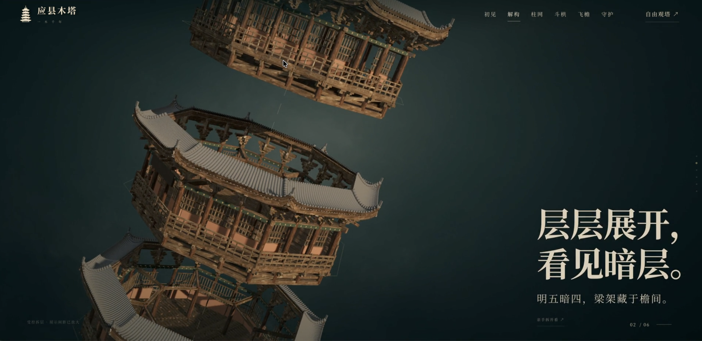

<h1 align="center">3D 视差滚动网站设计</h1>

  

  

从一张想法出发，做出会随着滚动展开的 3D 网站。

这份教程把[飞书原文](https://qcnzs9lwq68y.feishu.cn/wiki/EnfDwph0TiFIkOk3qI9cfEYonse)重新整理成新手能照着走的路线：**先设计六屏故事，再准备可拆分的 3D 模型，最后让滚动驱动网页动画。** 你可以用建筑、产品或自己的作品练习。教程讲的是制作流程；这个仓库本身是一份文档，不是已经做好的网站模板。

## 先看路线图

| 阶段 | 你要做什么 | 过关后的成果 | 跟着做 |
| --- | --- | --- | --- |
| 0 · 准备 | 选主题、收集参考、检查工具 | 一个放好素材的项目文件夹 | [先从这里开始](docs/01-getting-started.md) |
| 1 · 做设计 | 规划首页到收尾的六屏 | 六张设计图、统一规范、准确文案 | [设计六屏故事](docs/02-design-six-screens.md) |
| 2 · 做模型 | 分件、组装、导出 | `.blend` 工程、可用的 `.glb`、资产清单 | [制作可拆分模型](docs/03-build-the-model.md) |
| 3 · 嵌网站 | 让滚动控制相机、模型与文字 | 能在电脑和手机上预览的网站 | [搭建滚动网站](docs/04-build-the-website.md) |
| 4 · 打磨 | 看案例、排查问题、准备发布 | 经检查的成品 | [案例](docs/05-examples.md) · [排错与发布](docs/06-troubleshooting-and-publishing.md) |

> **第一次做？** 先用一个外形简单、资料齐全的物体练习。做好“整体展示 → 单个部件展开 → 归位”后，再把场景扩展成六屏。原文提到约 30 分钟完成示例；实际时间会随素材、建模复杂度和工具配置变化。

## 你需要准备什么

- 一组能看清外形的照片；想展示内部结构，还需要可靠的结构参考。
- Blender；如果要在本地运行网页，还需要 Node.js。AI 建模服务如 Aholo Lux3D 是可选的补充工具。
- 一个能够读取项目文件、帮助生成设计与代码的 AI 工作环境。教程以原文的 Codex 工作流为例，你也可以按自己的工具调整。

不熟悉术语也没关系：**GLB** 是适合网页加载的 3D 文件；**分件** 是让表盘、表针等部位分别成为可控制的对象；**视差** 是让背景、文字和模型随滚动以不同方式运动。详细操作从[准备篇](docs/01-getting-started.md)开始。

## 可以直接复制的提示词

| 提示词 | 用途 |
| --- | --- |
| [① 六屏设计稿](prompts/01-design.md) | 帮你规划并生成统一风格的六张页面设计图 |
| [② 分件建模](prompts/02-model.md) | 按参考资料选择建模方式，组装并导出 GLB |
| [③ 视差滚动网站](prompts/03-website.md) | 读取设计和模型，生成可预览的交互网页 |

方括号里的内容要换成自己的主题。提示词只是起点；每个阶段都要亲自检查输出，再进入下一步。

## 教程边界与来源

本仓库根据[《3D 视差滚动网站设计》飞书知识库](https://qcnzs9lwq68y.feishu.cn/wiki/EnfDwph0TiFIkOk3qI9cfEYonse)改写和编排。案例中的产品参数、建筑数据、插件速度和费用均以原资料或实际产品页面为准；发布前请自行核对。原文内嵌的视频和部分设计图没有复制进仓库，演示请回到原文查看。封面图片由仓库创建者提供。

涉及 Blender、React Three Fiber、Drei 和 Aholo Lux3D 的具体操作，请同时参考各自的[官方资料](docs/06-troubleshooting-and-publishing.md#参考资料)。
